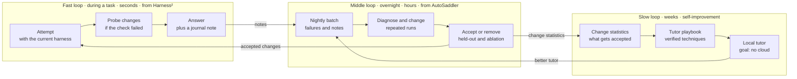
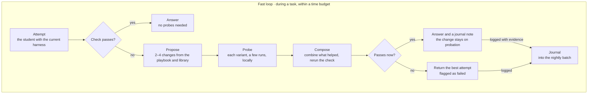
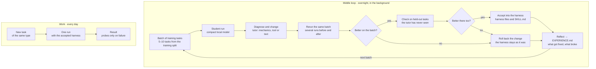
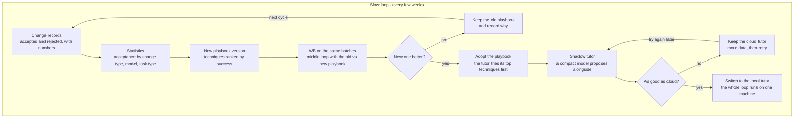
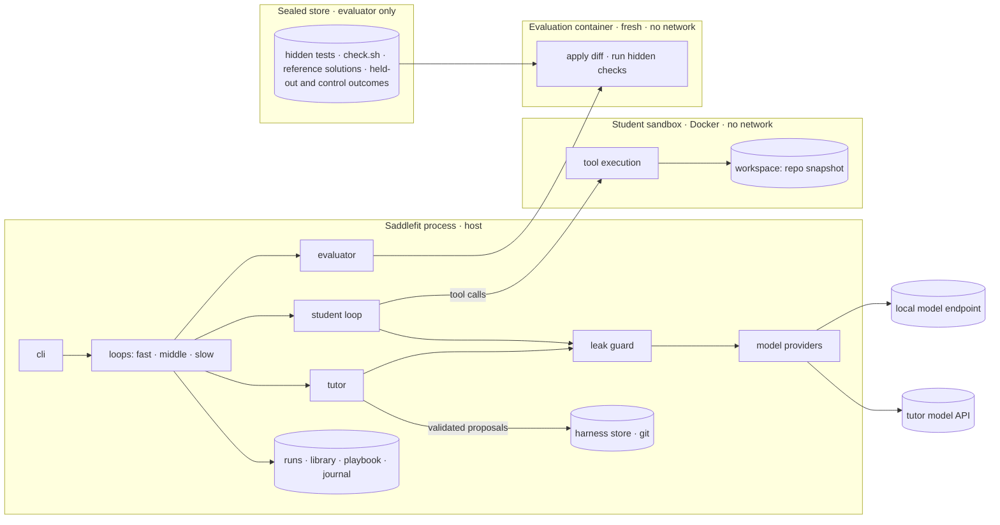
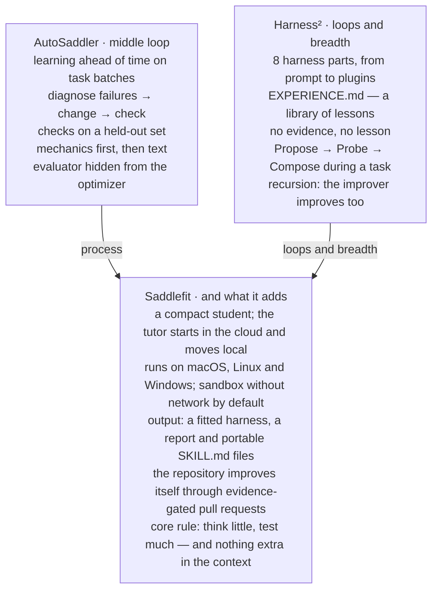
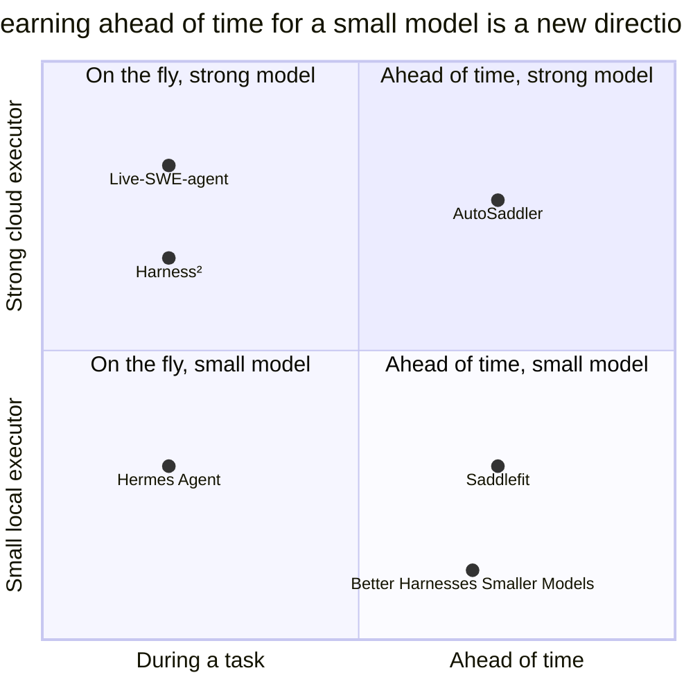

# Saddlefit — build specification

Spec version 1.0 · 2026-10-20 · Status: approved for implementation

Saddlefit fits an agent's harness to one compact model, on your own tasks. It adds what fixes failures, drops what stops helping, and proves each change on tasks the tutor never saw.

**How this document is organized**

- **Part 0 — Instructions for the implementing agent.** Mission, hard rules, owner-only steps, order of work. Read first.
- **Part A — Product.** What Saddlefit does and why.
- **Part B — Build contract.** Binding technical requirements: stack, architecture, formats, decision rules, isolation, tests.
- **Part C — Repository and delivery.** Binding requirements for the GitHub repository, CI, protection, CodeRabbit, versioning and the pull-request workflow.
- **Part D — Background.** Related work and sources; informative only.

If parts conflict, Part 0 wins, then Parts B and C, then Part A. The words MUST, MUST NOT, SHOULD and MAY are used as in RFC 2119.

**Glossary**

| Term | Meaning |
| --- | --- |
| Student | The compact local model that does the tasks. |
| Tutor | A strong model that diagnoses failures and proposes harness changes. |
| Generator | A strong model that writes new tasks; a separate role from the tutor. |
| Harness | The files around the student: system prompt, skills, tool guidance, tool scripts, loop settings, lessons. |
| Harness store | The git repository that holds the harness and its full history. |
| Task suite | All tasks of a project, each assigned once to the train, held-out or control split. |
| Sealed store | Hidden tests, check scripts, reference solutions and held-out/control outcomes. Only the evaluator reads it. |
| Proposal | One candidate harness change with its evidence. |
| Change record | The decision on a proposal, with numbers. |
| Playbook | Techniques ranked by how often they get accepted, per failure pattern and model tier. |
| Journal | Changes found by the fast loop, on probation until the middle loop accepts them. |
| Canary | A random string planted in sealed files to detect leaks into prompts. |

---

## Part 0 — Instructions for the implementing agent

### 0.1 Mission

Create a public GitHub repository named `saddlefit` and build the tool described here to a professional open-source standard: tested, versioned, reviewed by CodeRabbit, with protected branches and automated releases. Deliver it milestone by milestone (C9), starting with v0.1.0. Commit and merge your own pull requests once every gate in C8 is green.

### 0.2 Hard rules

1. Evaluation integrity comes first. The student, the tutor, the generator and the fast loop MUST NOT be able to read sealed data (B10).
2. The control set MUST be evaluated only through `saddlefit report --final`, never inside a fitting loop. Never tune Saddlefit's own code or defaults by looking at control results.
3. The tutor MUST change only allowlisted files in the harness store, and only through validated proposals (B8, B11). It never changes budgets or evaluation settings (B4).
4. After the bootstrap commit (C1), never push to `main`. Every change goes through a pull request.
5. Never merge with failing required checks, unresolved review threads or without CodeRabbit's approval (C8). Never use `--admin`, a ruleset bypass, or any setting change that weakens protection, CI or tests.
6. Never commit secrets. Keys come only from environment variables or repository secrets, and never reach logs, prompts or the sandbox.
7. Every change to a released persisted format bumps its `schema_version` and ships a migration and tests (C7). A format is released once a `vX.Y.Z` tag contains it; new and not-yet-released formats stay at their version (ADR 0002).
8. If the implementation must deviate from this spec, write an ADR in `docs/adr/` and update `docs/SPEC.md` in the same pull request.
9. When blocked by an owner-only step or by an ambiguity that affects evaluation integrity, stop, open an issue that explains the blocker, and wait.

### 0.3 Steps only the owner can do

Open a pinned issue titled "Owner actions" with these checkboxes, and wait where a step blocks progress:

- [ ] Authenticate the GitHub CLI with an account that can create and administer a public repository (`gh auth login`, scopes `repo` and `workflow`).
- [ ] Install the CodeRabbit GitHub App for this repository only: sign in at app.coderabbit.ai with GitHub and select the repository. CodeRabbit is free for public repositories.
- [ ] Provide a machine with Docker and a local model runner (Ollama recommended) for live tests and real fitting runs.
- [ ] Provide `ANTHROPIC_API_KEY` locally for tutor and generator calls. For stage 8, add it as a repository secret used only by scheduled workflows.
- [ ] Optional, before the first PyPI release: register a PyPI trusted publisher for `.github/workflows/publish.yml`.

Until CodeRabbit is installed, keep opening pull requests but do not merge them.

### 0.4 Order of work

1. Bootstrap and protect the repository (C1–C6).
2. Create GitHub milestones v0.1.0 to v0.6.0 and one issue per work item from C9.
3. Implement milestone by milestone through small pull requests (C8). Release at the end of each milestone (C7).
4. After each release, post a summary in the milestone's tracking issue: what shipped, test and coverage numbers, known gaps.

---

## Part A — Product

### A1. The idea in brief

Saddlefit is a small program that tunes everything around a compact model — prompt, skills, tools, loop mechanics — until the model finishes more of your tasks. The model's weights never change; only the files around it do.

- **Student** — a compact local model. It does the tasks, and its runs are nearly free.
- **Tutor** — a strong model behind an API. It reads failure logs and proposes changes; later the role can move to a compact model.
- **Harness** — a folder of files: system prompt, skills, tools, loop settings and reasoning mode, plus EXPERIENCE.md with lessons learned.

The harness grows and shrinks. A change stays only if it helps on tasks the tutor never saw, and it goes once it no longer pays for its place in the context.

The name comes from saddle fitting: a fitter adjusts a saddle to one particular horse, measuring and re-measuring. Saddlefit does the same for a harness and a model — and nods to [AutoSaddler](https://arxiv.org/html/2608.23041v1), whose training process it borrows.

### A2. Who benefits and how

The output is not a pile of skills but a measured fit: you learn exactly how well your compact model handles your work, and you get the harness that made it so.

**What you get after a fitting run:**

- **A fitted harness** for your model and your tasks — prompt, skills, tools, loop settings and reasoning mode, ready to use.
- **A report** — success on control tasks before and after, and success per 1,000 context tokens, broken down by task type.
- **A delegation map** — which task types the compact model handles reliably and which still need a cloud model.
- **Exports** — the fit as SKILL.md, AGENTS.md and hooks for other agents such as Claude Code, Codex, OpenCode or Hermes.
- **A failure profile** — where your model's mechanics break: context overflow, loops, unfinished tasks, malformed tool calls.

| Who | Problem today | What Saddlefit gives |
| --- | --- | --- |
| Developers running local agents (Ollama, LM Studio) | The local model loops, overflows its context or quits halfway | A harness fitted to their model, with measured gains on their own tasks |
| Teams whose code or data can't leave the building | Cloud agents are off the table | A private agent that improves on their code; fully local once the tutor is compact (stage 6) |
| Anyone with a large API bill | Routine tasks burn frontier tokens | A delegation map: move the task types the local model handles reliably |
| People choosing between models | A new compact model ships every month, with no way to know if it is better for them | A refit and a head-to-head report on their own tasks |
| Offline and edge work | No internet, modest hardware | An agent tuned for that exact machine and model |
| Model authors and the open-source community | Little data on how a model fails inside agents | Failure profiles and published harness packs with numbers |
| Researchers and students | Self-improvement experiments are expensive | Cheap local runs and a small, readable codebase |

The limit: Saddlefit helps only with task types that repeat and can be checked automatically.

### A3. What counts as a compact model

In Saddlefit, a compact model is an open-weight language model that runs entirely on one consumer machine. It must meet four conditions, and `saddlefit doctor` checks all four:

1. **Memory.** At 4-bit quantization, the weights plus a 32k-token context fit in 24 GB or less.
2. **Active size.** At most about 10B parameters are active per token. A dense model counts all of them; a mixture-of-experts model counts only the active ones, so a 30B-A3B model qualifies.
3. **Speed.** Roughly 20 tokens per second or more on the target machine — enough for hundreds of agent runs per night.
4. **Tool use.** It calls tools reliably, natively or through constrained JSON output.

| Tier | What it is | Typical hardware | Examples |
| --- | --- | --- | --- |
| S | dense, 1–4B | 8–16 GB laptops, CPU only | Qwen3 4B; 1-bit Bonsai 1.7B and 4B |
| M | dense, 4–10B, or a looped model | 16–18 GB Macs, GPUs with 8–12 GB | Qwen3 8B, 1-bit Bonsai 8B; looped: Ouro 1.4B and 2.6B, Huginn 3.5B |
| L | mixture of experts, up to ~35B total and ~5B active | 32–36 GB Macs, 24 GB GPUs | qwen3-coder:30b (30B-A3B, about 19 GB) |

Examples show size classes; tool-use quality still has to be checked per model. Not compact: anything that needs more than 24 GB at 4-bit, multi-GPU servers and frontier API models.

Why these lines: memory decides whether a model runs at all, active size decides its speed, and speed decides how many cheap checks fit into a night. The range matches the 2–9B models in which [Mingbird](https://arxiv.org/abs/2610.02001) documents small-model failures, plus the 35B tier it also tested.

### A4. Why compact models

Compact models are where agents on your own hardware are heading — and they need a different harness and a different way to improve it.

**They break on mechanics, not knowledge.** Inside harnesses built for cloud flagships, 2–9B models rarely finish real tasks: tool descriptions overflow the context, self-correction diverges, tool demonstrations loop, and tasks are silently abandoned. Much of this is the harness's fault, not the model's ([Mingbird](https://arxiv.org/abs/2610.02001)).

**Their economics are mirrored.** Existing harness optimizers are built for cloud models: runs are expensive, so they are rationed, and a strong model does the analysis. With a local compact model it is the other way round: runs are nearly free, while the tutor's intelligence, context and time are scarce.

**They are getting denser fast.** A 1-bit 8B model already fits in 1.15 GB of memory ([The Register](https://www.theregister.com/2026/04/04/prismml_1bit_llm/)).

Hence the rule **think little, test much**:

1. **Many cheap checks.** Every change is run several times: statistics instead of luck, which also dampens the noise of small models.
2. **Few expensive thoughts.** The strong model is called rarely — only to diagnose and to propose changes.
3. **Context is a hard budget.** The goal is not just success but success per unit of context.

The limit is honest: a harness does not make a model smarter than it is. On tasks beyond the model's ability, harness changes do not help ([HSI](https://arxiv.org/abs/2608.08466)).

### A5. How it works: three loops

Improvement runs at three speeds, and each loop leans on what is cheap for a compact model.



- **Fast — during a task (from Harness²).** If the first attempt fails the task's own check — the project's tests or a command the user gives — the student tries a few harness variants locally and keeps the best: Propose → Probe → Compose. In the cloud one such step costs 4 executor runs; locally it costs next to nothing. The finding goes into a journal.
- **Middle — overnight (from AutoSaddler).** The day's failures and findings go through diagnose → change → check. A change is accepted only after repeated runs on held-out tasks, and anything that stops helping is pruned by ablation.
- **Slow — the tutor improves itself.** Statistics on which changes get accepted for compact models grow into the tutor's playbook — with checks, because in [VERSE](https://arxiv.org/pdf/2610.02616) an optimizer that evolved itself without verification never beat the starting harness. The end goal is moving the tutor's role to a compact model: in [Harness-R1](https://arxiv.org/html/2608.02276) a 9B "harness engineer" raised held-out success by 8.9 points, while frontier engineers averaged below zero.

### A6. The fast loop in detail

The fast loop rescues a single task during work: when the task's own check fails, the student probes a few harness changes locally and keeps what passes. Nothing it finds becomes permanent until the middle loop confirms it overnight.



- **Trigger.** Only a failed check that the student is allowed to see — the project's tests or a command the user gives. Hidden checks and held-out tasks are never used here.
- **Propose, without the strong model.** Candidates come from the tutor's playbook and from changes already accepted for similar task types, so no cloud call is needed. Before the slow loop exists, a starter playbook ships with Saddlefit: known small-model mechanics such as a finish gate that re-reads the task, signature-level loop detection and a context budget ([Mingbird](https://arxiv.org/abs/2610.02001)).
- **Probe.** Each variant runs a few times locally; it counts only if it passes in most runs.
- **Compose.** The variants that helped are combined, and the check runs once more.
- **Probation.** A change found here is used only for this task and logged with its evidence. It enters the harness only if the middle loop accepts it on held-out tasks.
- **Budget.** A fixed number of variants and runs, and a time limit. When the budget runs out, the student returns its best attempt, flagged as failed, and the failure goes to the nightly batch.

This is Harness²'s Propose → Probe → Compose with two differences: the task's check judges the probes instead of behavioural contrast, and proposals come from the playbook instead of a strong editor model.

### A7. The middle loop in detail

The diagram follows one change from failure to harness. The key difference from AutoSaddler: every check uses several repeated runs, not one — cheap for a compact model, and it dampens noise.



### A8. The slow loop in detail

The slow loop improves the improver: every few weeks it turns the record of accepted and rejected changes into a better tutor — and eventually into a tutor that runs locally.



1. **Records.** Every change the tutor has ever proposed is stored with its numbers, whether it was accepted or not.
2. **Statistics.** Acceptance rates by change level, failure pattern, model tier and task type — for example, how often a mapping-table skill fixes API-migration failures on 8B models.
3. **Playbook.** Techniques are ranked by those rates. The tutor tries the top technique for a failure pattern first, and the fast loop draws its candidates from the same list.
4. **A/B gate.** A new playbook runs the middle loop on the same batches as the old one and is adopted only if it yields more accepted changes per tutor call. Without this gate, self-evolution backfires: in [VERSE](https://arxiv.org/pdf/2610.02616), an optimizer that rewrote itself without verification never beat the starting harness.
5. **Shadow tutor.** A compact model proposes changes alongside the cloud tutor on the same failures. Once its changes are accepted about as often, it takes over, and the whole loop runs on one machine. [Harness-R1](https://arxiv.org/html/2608.02276) shows the ceiling is high: its 9B engineer beat frontier engineers on held-out tasks.

Records are labelled by model tier, so a technique proven on one tier is not assumed for another. A later step, outside the first version: fine-tune the compact tutor on accepted changes, as Harness-R1 does with reinforcement learning.

### A9. Example: migrating a service to Pydantic v2

A typical job: a service has 40 files with Pydantic v1 models, and each must move to v2 with tests passing and no deprecation warnings. The job repeats 40 times and checks itself — exactly what Saddlefit is for. The numbers below are illustrative.

**Nights 1–2: the middle loop.**

1. **Tasks.** Take 24 files: 12 for training, 6 held out and 6 for control. Each task is checked by `pytest -W error::DeprecationWarning` on that module's tests: old Pydantic methods emit warnings, and the flag turns them into errors.
2. **Baseline.** The student is a local 8B model. On a batch of 6 training files it succeeds twice: elsewhere it keeps `.dict()` and `@validator`, and once it forgets `class Config`.
3. **Diagnosis.** The tutor reads the logs and finds one cause: the model writes the old way and stops without running the tests.
4. **Change.** A new skill, pydantic-v2-migration, with a mapping table and a rule to run the tests before answering. Plus a small script that finds old constructs in a file — a new tool, not just a text hint.
5. **Checks.** On the batch rerun, with three runs per task, 5 of 6 tasks pass in most runs. On held-out tasks the score goes from 2 of 6 to 4 of 6, so the change is accepted and a lesson goes into EXPERIENCE.md.
6. **Second round** fixes validators that read sibling fields through `values`: in v2 that data comes from `info.data`.
7. **Result on control tasks:** 2 of 6 before, 5 of 6 after.

**Day 3: the fast loop at work.** The student migrates the remaining 16 files, one run each. One module still uses `class Config` with `orm_mode = True`, which the skill does not cover, and the module's tests fail. The fast loop proposes three variants from the library and probes each twice; the one that maps `orm_mode` to `from_attributes=True` passes. The task is answered, and the change goes into the journal on probation. That night the middle loop tests it on held-out files and adds it to the skill.

**Week 3: the slow loop.** The records now span two projects and show a pattern. For API migrations on 8B models, a mapping table in a skill is accepted far more often than prompt rules. The new playbook puts "write a mapping table" first for migration failures and wins the A/B run on old batches. A local 8B shadow tutor starts proposing the same kind of change on its own. Once its changes pass as often as the cloud tutor's, it takes over migrations.

The skill after day 3, ready to share with colleagues who use Claude Code or Codex:

```markdown
---
name: pydantic-v2-migration
description: Migrating Pydantic v1 models to v2 in this service
---
- `.dict()` → `.model_dump()`, `.json()` → `.model_dump_json()`
- `parse_obj()` → `model_validate()`
- `@validator` → `@field_validator`, `@root_validator` → `@model_validator`
- `class Config:` → `model_config = ConfigDict(...)`
- `orm_mode = True` → `ConfigDict(from_attributes=True)`
  (found by the fast loop on day 3, accepted that night)
- in validators, `values` → `info.data`
- Before answering, run scripts/find_v1.py and the module's tests with
  `-W error::DeprecationWarning`; any warning is a failure.
```

And the lesson in EXPERIENCE.md:

```markdown
- Compact models don't know the Pydantic v2 API: a mapping table in a skill helped,
  a general "write modern code" line in the prompt did not (round 1, held-out 2/6 → 4/6).
```

### A10. What the tutor can change

Changes come in levels, from text to mechanics. For compact models the lower rows of the table matter most.

| Level | Examples | Why it matters for compact models |
| --- | --- | --- |
| Text | system prompt, skills, tool descriptions | short, targeted rules work; long instructions get lost |
| Tools | a new checking script, fixed parameters | moves work from the model to code |
| Loop mechanics | output truncation, context budget, a check before finishing, loop detection | this is where 2–9B models break |
| Reasoning mode | reasoning language, amount, latent depth for looped models | unneeded reasoning tokens cost context and time |

The order follows [AutoSaddler](https://arxiv.org/html/2608.23041v1): mechanics and tools first, text second. There such changes were accepted most often — 83% for new tools and 71% for loop changes. Without that structure the optimizer almost always drifted into prompt hints.

**Reasoning language.** Models generally reason better in English, and the gap grows with task difficulty ([The Reasoning Lingua Franca](https://arxiv.org/html/2510.20647)). For 4B and 8B models, mixed reasoning worked best: logic in English, key terms in the user's language ([Language-Mixed CoT](https://arxiv.org/html/2510.04230)). The middle loop decides what works for your model and tasks.

**Latent depth.** Looped models such as [Ouro](https://huggingface.co/ByteDance/Ouro-1.4B) and [Huginn](https://huggingface.co/tomg-group-umd/huginn-0125) let you set the number of internal iterations — thinking deeper without extra tokens. That is one more setting for the middle loop to tune. Text stays at the boundaries — tool calls and the answer — so log-based diagnosis keeps working.

### A11. Where tasks come from

Saddlefit needs tasks with automatic checks. They come from three sources, in order of trust.

1. **Your git history.** A commit that changed code and tests becomes a task: its tests fail on the parent commit and pass on the commit itself. These are the most trusted tasks, and control sets come only from here or from tasks the user writes.
2. **Bugs injected into working code.** The approach of [SWE-smith](https://arxiv.org/abs/2504.21798v2): change working code so that existing tests break, then have a model write the task as an issue. SWE-smith produced 50,000 such tasks from 128 repositories.
3. **Tasks written by a strong model.** For task types your history lacks, a generator writes the task, a check and a hidden reference solution.

A generated task is accepted only if its check fails without the reference solution and passes with it. Then it is calibrated: the most useful tasks are those the student solves sometimes — not never, not always.

**Can Claude Fable write them?** Yes. Claude Fable 5.1 is the most capable generally available Claude model, and generation is a rare, one-off cost that fits "think little". One caveat: Fable carries silent safeguards that limit help with frontier LLM development, such as pretraining pipelines and training infrastructure ([system card](https://www-cdn.anthropic.com/0339e6a7c5c7b87f5c07798616dc32c215d14235/Claude%20Fable%205.1%20&%20Claude%20Mythos%205.1%20System%20Card.pdf), [analysis](https://www.lesswrong.com/posts/sSyLyc3KDQzboQGWS/thoughts-on-claude-fable-s-silent-safeguards)). Saddlefit is not that kind of work, and Anthropic says most coding is unaffected. Still, the limits are invisible, so compare a small batch against Claude Opus 5.5 before relying on Fable.

Two rules hold for every source: the generator is a separate role from the tutor, and the student never sees checks or reference solutions.

### A12. The self-improving repository

The repository itself improves too, at three levels, each gated by evidence and a human-reviewed merge.

1. **Saddlefit learns its own code.** Tasks are mined from Saddlefit's own git history, and accepted changes become a saddlefit-dev skill for contributors. This is also the first live test of the approach.
2. **Self-improving defaults.** A scheduled CI job runs the middle loop for popular compact models on a public task suite. Accepted harness changes arrive as pull requests with before-and-after numbers, and go through the same review gates as any other change. Each release ships better harness packs per model.
3. **A shared playbook, opt-in.** Users may share accepted changes and their statistics — never code or data. The slow loop learns which fixes work for which model across many machines, and the defaults improve for everyone.

The repository never merges its own automated changes without the full gate: held-out evaluation in CI, CodeRabbit review and the owner's merge. Developing a project through itself is not new ([Harness Anything](https://github.com/FairladyZ625/harness-anything/wiki)); the new part is evidence-gated pull requests with numbers for compact models, and per-model harness packs.

---

## Part B — Build contract

### B1. Technology stack

| Concern | Choice | Notes |
| --- | --- | --- |
| Language | Python 3.12+ | CI on 3.12, 3.13 and 3.14 |
| Packaging | uv, `pyproject.toml`, hatchling build backend, committed `uv.lock` | src layout |
| CLI | Typer | every command also supports `--json` output |
| Configuration and schemas | Pydantic v2 | JSON Schemas generated into `schemas/`; CI checks they are current |
| Student models | `openai` SDK against OpenAI-compatible endpoints | Ollama, LM Studio, llama.cpp server, vLLM |
| Tutor and generator | `anthropic` SDK | model IDs live in config, e.g. `claude-opus-5-5`, `claude-fable-5-1` |
| Sandbox | Docker through the `docker` Python SDK | Docker Desktop on macOS and Windows |
| Git | `git` CLI through subprocess | harness store and task mining |
| YAML | PyYAML, safe loader only | |
| Identifiers | ULIDs (`python-ulid`) | sortable run and proposal IDs |
| Tests | pytest, pytest-cov, hypothesis, pytest-socket | network blocked by default |
| Quality | ruff (lint and format), mypy, pre-commit, pip-audit | |
| License | Apache-2.0 | |

Runtime dependencies MUST stay minimal: no agent frameworks. Anything not listed needs an ADR.

### B2. Architecture



- The student loop runs on the host, so model calls never leave from inside the sandbox; tools run in the sandbox through `docker exec`.
- Every prompt to any model passes through the leak guard (B10).
- Only the evaluator reads the sealed store; it is never mounted into the student sandbox.

| Package (`src/saddlefit/`) | Responsibility |
| --- | --- |
| `providers` | `ModelClient` protocol; OpenAI-compatible, Anthropic, fake and (stage 7) looped providers |
| `student` | agent loop, tool-calling modes, finish gate, loop detection, compaction |
| `context` | context assembly and budgets |
| `tools` | read, list, search, edit, write, bash, finish |
| `sandbox` | container lifecycle, limits, mounts |
| `harness` | harness store (git), proposal validation and application, allowlist, `loop.yaml` schema |
| `tasks` | suite, splits, canaries, mining, mutation, generation |
| `eval` | evaluator, tamper detection, failure taxonomy, statistics, leak guard |
| `loops` | fast, middle and slow loops |
| `tutor` | diagnosis and proposals; prompts as Markdown files |
| `reports` | reports, delegation map, failure profile |
| `export` | SKILL.md, AGENTS.md, hooks |
| `storage` | JSONL runs, library, playbook, journal; schema migrations |
| `config`, `cli` | configuration and commands |

### B3. Runtime workspace

Saddlefit keeps all state for one project in `.saddlefit/` at the project root. `init` adds it to `.gitignore`.

```
.saddlefit/
  saddlefit.yaml            # configuration (B4)
  harness/                  # the current harness; its own git repository (the harness store)
    systemprompt.md
    skills/<name>/SKILL.md
    tool_guidance.md
    tools/                  # extra tool scripts; run only inside the sandbox
    loop.yaml
    EXPERIENCE.md
  tasks/
    suite.lock              # task IDs, content hashes, splits, salt digest
    public/<task-id>/       # task.md and meta.yaml; models see them only as B10 allows
    sealed/<task-id>/       # hidden tests, check.sh, reference solution, canary,
                            # hidden-check output: evaluator only
  runs/<yyyy-mm-dd>/<run-id>.jsonl
  library/<change-id>.json
  playbook/<entry-id>.json
  journal/<entry-id>.json   # fast-loop changes on probation
  reports/<report-id>.md, <report-id>.json
```

- `sealed/` MUST NOT be mounted into any container except the evaluation container, and MUST NOT be read by code outside `saddlefit.eval`. A test enforces this import boundary.
- The harness store is a git repository. Every candidate change is a commit on `candidate/<proposal-id>`; accepted changes are merged into its `main`; pruned changes are reverted with a recorded reason. Every run records the harness commit SHA.
- Each fitting session works in its own subdirectory and containers; parallel sessions never share mutable state.

### B4. Configuration

`saddlefit init` writes `.saddlefit/saddlefit.yaml`. Unknown keys are errors with clear messages.

```yaml
schema_version: 1
project: my-service
student:
  provider: openai-compatible        # openai-compatible | fake | looped (stage 7)
  base_url: http://localhost:11434/v1
  model: qwen3:8b
  tool_mode: auto                    # auto | native | json
  temperature: 0.2
  seed: 7
  context_length: 32768
  release_date: null                 # optional; enables contamination flags (B10)
tutor:
  provider: anthropic
  model: claude-opus-5-5
  max_calls_per_round: 20
  max_usd_per_round: 5.0
  prices_usd_per_mtok: {input: 0.0, output: 0.0}   # fill in from your price list; never hardcoded
generator:
  provider: anthropic
  model: claude-fable-5-1
evaluation:
  runs_per_task: 3
  solved_threshold: 2
  timeout_seconds: 900
  protected_paths: ["tests/**", "**/test_*.py", "**/*_test.py"]
splits:
  train: 0.5
  held_out: 0.25
  control: 0.25                      # the salt is created at init and stored in suite.lock
sandbox:
  image: ghcr.io/OWNER/saddlefit-sandbox:0.1.0
  cpus: 2
  memory: 4g
  pids_limit: 512
fast_loop:
  max_variants: 3
  runs_per_variant: 2
  time_budget_minutes: 10
```

Budgets, limits and evaluation settings live only in this file, which no model can edit. Values in `loop.yaml` are clamped to these limits: `max_steps` can never stretch a run past `evaluation.timeout_seconds`, and context budgets never exceed `student.context_length`.

### B5. Model providers

```python
class ModelClient(Protocol):
    def info(self) -> ModelInfo: ...
    def chat(
        self,
        messages: Sequence[Message],
        tools: Sequence[ToolSpec] | None,
        params: GenParams,
    ) -> ModelReply: ...
```

- `ModelInfo`: provider, model, digest when the runner exposes one, context length, tool mode, runner version.
- `ModelReply`: text, parsed tool calls, raw response, usage (prompt and completion tokens), latency, and whether a repair was needed.

| Provider | Used for | Details |
| --- | --- | --- |
| `openai-compatible` | student | `base_url` plus model name. Works with Ollama (`/v1`), LM Studio, llama.cpp server and vLLM. With Ollama, also read the model digest from its native API. |
| `anthropic` | tutor, generator | Messages API with tool use for structured proposals. |
| `fake` | tests | Replays scripted replies from fixtures; fully deterministic. |
| `looped` | student, stage 7 | Hugging Face transformers for looped models such as Ouro and Huginn; exposes latent depth. Optional extra `saddlefit[looped]`. |

**Tool-calling modes.**

- `native`: the OpenAI `tools` parameter.
- `json`: the model answers with one JSON object, `{"tool": "...", "args": {...}}`, validated against a JSON Schema. Where the runner supports schema-constrained output, use it.
- `auto`: `saddlefit doctor` runs 10 tool-call probes; `native` if at least 9 succeed, otherwise `json`. The result is stored together with the model digest.

**Parsing and repair.** Tolerant JSON extraction (code fences, trailing commas), one repair attempt. An unrecoverable call goes back to the model as a tool error and counts toward `malformed_tool_call`.

**Reliability.** Per-call timeouts (default 120 s for local models, 300 s for APIs). Up to 3 retries with exponential backoff and jitter for transient errors (429, 5xx, connection resets). Tool executions are never retried automatically.

**Secrets.** Keys come only from environment variables such as `ANTHROPIC_API_KEY`. A log filter redacts anything shaped like a key. The sandbox receives only an allowlist of environment variables (`PATH`, `HOME`, `LANG`).

**`saddlefit doctor`.** Checks Docker, runner reachability, model info and digest, tokens per second on a fixed prompt, tool-call probes and context length. It prints the compact-model tier (A3), or "not compact" with the condition that failed.

**Runner notes.** Ollama runs on macOS, Linux and Windows and serves an OpenAI-compatible API at `localhost:11434/v1`; on Apple Silicon it uses MLX ([setup notes](https://gist.github.com/greenstevester/fc49b4e60a4fef9effc79066c1033ae5)). Don't go below 4-bit quantization, or tool calls suffer. macOS gives the GPU about 2/3–3/4 of memory by default, and an M3 Pro has about 150 GB/s of memory bandwidth, so dense models over 15 GB run slowly ([review of local models](https://www.analyticsvidhya.com/blog/2026/09/best-local-llms-mac-mini-2026/)). Stock Ollama and LM Studio don't load Ouro yet; use a [patched llama.cpp build](https://github.com/BrandeisPatrick/loop-transformer) or Hugging Face transformers.

### B6. The student loop and tools

| Tool | Purpose | Notes |
| --- | --- | --- |
| `read_file(path, start?, end?)` | read a file or a line range | output capped by `tool_output.max_chars` |
| `list_dir(path)` | list a directory | |
| `search(pattern, path?)` | search with ripgrep | output capped |
| `edit_file(path, old, new)` | exact search-and-replace edit | preferred over rewriting whole files |
| `write_file(path, content)` | create or overwrite a file | |
| `bash(command, timeout?)` | run a command | inside the sandbox, no network |
| `finish(summary)` | end the task | triggers the finish gate |

All paths are confined to `/work` in the sandbox.

**Loop.** Assemble the context (B7) → call the model → execute tool calls → append results (head and tail kept, with a truncation marker) → loop detection → compaction when the context passes 80% of its budget → repeat until `finish`, the step limit or the time limit.

**Finish gate** (configured in `loop.yaml`). Optionally re-read the task, then run the task's `visible_check`, or `finish_gate.run` when the task has none. On failure, return the output to the model once (`finish_gate.max_retries`, default 1).

**Loop detection.** A signature is the tool name plus a hash of normalized arguments. After N identical signatures with no workspace change (default 3), inject a warning; the next time, stop with the tag `loop`.

**Compaction.** Drop the oldest tool outputs first, keeping a one-line stub ("output of read_file src/x.py dropped; re-read if needed"). Never drop the task text or the latest error.

**`loop.yaml`**, an example of the full schema:

```yaml
schema_version: 1
max_steps: 40
tool_output:
  max_chars: 4000           # longer output is cut, with a note
context:
  budget_tokens: 24000
  harness_budget_tokens: 4000
finish_gate:
  reread_task: true
  run: "pytest -q"          # the project's visible tests, never check.sh
  max_retries: 1
loop_detection:
  identical_calls: 3        # stop after 3 identical calls with no progress
reasoning:
  language: mixed           # english | user | mixed
  effort: low               # off | low | high
  latent_depth: null        # looped models only, e.g. 2 to 4
```

The tutor may edit `loop.yaml`, so it holds only behaviour settings. Budgets for the fast loop and for tutor calls live in `saddlefit.yaml` (B4).

### B7. Context assembly

- **Order:** system prompt → tool guidance for enabled tools only → selected skills → relevant EXPERIENCE.md lessons → task text.
- **Skill selection:** by the task type in `meta.yaml` or the skill's description; at most `max_skills` skills (default 3).
- **Budget:** the harness share of the context is capped by tier — S 2,500 tokens, M 4,000, L 6,000 — and configurable. When over budget, drop in this order: lessons, lower-ranked skills, tool-guidance details. The task text is never cut.
- **Token counting:** the runner's tokenizer when available, otherwise a conservative estimate of characters ÷ 3.
- The assembler records `harness_tokens` for every run; reports use it for context efficiency.

### B8. Data formats

Every persisted format carries an integer `schema_version`. Pydantic models are the source of truth; JSON Schemas are generated into `schemas/`.

**Task, public part** (`tasks/public/<id>/meta.yaml`; `task.md` holds the text the student sees):

```yaml
schema_version: 1
id: fix-date-parser-0042
source: history                 # history | mutation | generated | user
type: bugfix
split: train                    # train | held_out | control; assigned once (B10)
repo:
  url: https://github.com/OWNER/project
  base_commit: 3f2a9c1
visible_check: "pytest -q tests/test_dates.py"
created: 2026-10-21
```

**Task, sealed part** (`tasks/sealed/<id>/`): `check.sh` (exit code 0 means solved), `hidden_tests/` (copied into the evaluation container only), `target_commit` for history tasks, `reference.patch` for generated tasks, `canary.txt`, and the output of every hidden-check run. The canary is also embedded as a comment in the hidden tests and in `check.sh`.

**Run record** (`runs/<date>/<run-id>.jsonl`): one event per line, ending with a summary. Event types: `model_call`, `tool_call`, `compaction`, `loop_warning`, `finish_gate`, `error`.

```json
{
  "schema_version": 1,
  "type": "summary",
  "run_id": "01JB2Y8Q4V9N1K3D7M5R6T0W2X",
  "task_id": "fix-date-parser-0042",
  "split": "train",
  "attempt": 2,
  "model": {"id": "qwen3:8b", "digest": "sha256:…", "runner": "ollama", "tool_mode": "native"},
  "harness_commit": "a1b2c3d",
  "saddlefit_version": "0.2.0",
  "suite_hash": "sha256:…",
  "sandbox_image": "sha256:…",
  "seed": 8,
  "steps": 23,
  "prompt_tokens": 18431,
  "completion_tokens": 2210,
  "harness_tokens": 3120,
  "wall_seconds": 182.4,
  "outcome": "fail",
  "primary_tag": "gave_up",
  "tags": ["gave_up"],
  "check": {"exit_code": 1, "duration_s": 12.3},
  "diff_stats": {"files": 2, "insertions": 14, "deletions": 3}
}
```

The run record keeps only the hidden check's exit code and duration; its output stays in the sealed store.

**Proposal** (from the tutor, the fast loop or the playbook):

```json
{
  "schema_version": 1,
  "proposal_id": "01JB2Z0C7H2P6S8E4F1A9B3D5G",
  "source": "tutor",
  "level": "mechanics",
  "failure_tags": ["gave_up"],
  "evidence_run_ids": ["01JB2Y8Q4V9N1K3D7M5R6T0W2X"],
  "technique": "finish gate: run the visible tests",
  "rationale": "In 3 of 4 failed runs the student finished without running the tests.",
  "patch": "diff --git a/loop.yaml b/loop.yaml\n…",
  "expected_effect": "Fewer gave_up failures on bugfix tasks",
  "context_tokens_delta": 40
}
```

**Change record** (`library/<id>.json`):

```json
{
  "schema_version": 1,
  "id": "2026-10-21-003",
  "proposal_id": "01JB2Z0C7H2P6S8E4F1A9B3D5G",
  "model": "qwen3:8b",
  "model_digest": "sha256:…",
  "level": "mechanics",
  "files": ["loop.yaml"],
  "harness_commit": "b4c5d6e",
  "status": "accepted",
  "train": {"before": 2, "after": 5, "tasks": 6, "runs_per_task": 3},
  "held_out": {"wins": 2, "losses": 0, "tasks": 6, "runs_per_task": 3},
  "context_tokens_added": 140
}
```

`status` is `accepted`, `rejected` or `pruned`.

**Playbook entry** (`playbook/<id>.json`, one per technique and model tier):

```json
{
  "schema_version": 1,
  "technique": "mapping table in a skill",
  "failure_pattern": "API migration: old calls kept",
  "level": "text",
  "model_tier": "M",
  "proposed": 14,
  "accepted": 9,
  "acceptance_rate": 0.64,
  "playbook_version": 3
}
```

**Journal entry** (`journal/<id>.json`): `schema_version`, `entry_id`, task reference, the proposal, probe run IDs, `passed`, and `status` (`probation`, `accepted` or `rejected`).

**Proposal validation** before anything is applied:

- the patch applies cleanly to the harness store;
- it touches only allowlisted paths: `systemprompt.md`, `skills/**`, `tool_guidance.md`, `tools/**`, `loop.yaml`, `EXPERIENCE.md`;
- it changes at most 200 lines;
- `loop.yaml` still validates against its schema;
- new tool scripts pass ruff (Python) or shellcheck (shell) and run only inside the sandbox.

### B9. Failure taxonomy

Each run gets exactly one primary tag — the highest-priority match — and may carry secondary tags.

| Priority | Tag | Signal |
| --- | --- | --- |
| 1 | `env_error` | sandbox or runner failure; excluded from statistics and rerun |
| 2 | `tampered` | the diff touches `evaluation.protected_paths` or the hidden tests' paths |
| 3 | `timeout` | step or time limit reached |
| 4 | `context_overflow` | prompt tokens reached 95% of the context, or a context-length error |
| 5 | `malformed_tool_call` | 3 or more unrecoverable tool-call parses in one run |
| 6 | `loop` | stopped by loop detection |
| 7 | `gave_up` | finished without running the visible check, or with an empty diff |
| 8 | `tool_error` | 3 or more consecutive failing tool executions |
| 9 | `check_fail` | finished normally, but the check failed |
| — | `solved` | the check passed |

The taxonomy feeds the tutor's evidence, the fast loop's candidate lookup and the failure profile report.

### B10. Evaluation integrity and isolation

**Who can see what:**

| Data | Student | Tutor | Fast loop | Evaluator | Reports |
| --- | --- | --- | --- | --- | --- |
| `task.md`, repo snapshot, visible check output | yes | training tasks only | yes | yes | yes |
| Training traces | — | yes, redacted | — | yes | yes |
| Held-out traces and per-task outcomes | no | no | no | yes | aggregates only |
| Control outcomes | no | no | no | only in `report --final` | yes, after `--final` |
| Hidden tests, `check.sh`, reference solutions | no | no | no | yes | no |
| Hidden-check output | no | no | no | yes | no |

**Mechanisms:**

1. **Deterministic splits.** A task's split comes from HMAC-SHA256(salt, task_id) mapped onto the configured fractions. The salt is created at `init` and stored in `suite.lock`. A task's split never changes, and adding tasks never moves existing ones.
2. **Sealed store and fresh evaluation.** The evaluator builds a fresh container from the base snapshot, applies the student's diff, adds the hidden tests and runs `check.sh`. A diff that touches `evaluation.protected_paths` or the hidden tests' paths makes the run `tampered`.
3. **Canaries.** Each sealed task has a random canary string, embedded as a comment in its hidden tests and check script. The leak guard scans every outgoing prompt for all known canaries. A hit aborts the run with exit code 2 and logs an incident.
4. **Coarse tutor feedback.** For each proposal the tutor learns only whether it was accepted and the aggregate counts (wins, losses) — never held-out task contents or per-task outcomes.
5. **Control lock.** Control tasks run only through `saddlefit report --final`, on a harness frozen with a tag in the harness store. Every control evaluation is logged and counted, and reports print the count.
6. **Repeated runs and paired statistics** (B12).
7. **Reproducibility.** Each run records the student model ID and digest, runner, temperature, seed, harness commit, Saddlefit version, task-suite hash, sandbox image digest and a host summary. `saddlefit replay <run-id>` reruns with the same settings; sampling may still vary.
8. **Contamination flag.** Tasks mined from public history before the student model's release date are flagged. Control sets SHOULD prefer later commits or private code.

**Known traps** — each must have a test or a control from day one:

- **Phantom fixes.** The optimizer "fixes" problems that don't exist ([Phantom Guardrails](https://arxiv.org/pdf/2607.13083)). The defence is held-out and control tasks.
- **Peeking.** The student and the tutor must never see `check.sh` or reference answers.
- **Model coupling.** Notes tuned for one model can move another model's results by 10–13 points either way ([study](https://arxiv.org/abs/2609.05339)); every record is labelled with its model.
- **Randomness.** Compact models are noisy: every check uses several runs, not one.
- **The model's ceiling.** If a task is beyond the model, no harness will help ([HSI](https://arxiv.org/abs/2608.08466)); such tasks are flagged and skipped in later rounds.

### B11. Sandbox and security

- **Student sandbox.** Docker with `--network none`, a non-root user, a read-only root filesystem except `/work` and `/tmp`, CPU, memory and pids limits, no host mounts except the run's workspace, an environment-variable allowlist, and wall-clock timeouts per command and per run.
- **Environment images.** Per task suite, dependencies are installed into a derived image in a separate build step that may use the network. Student runs never get network access.
- **Evaluation container.** Fresh for every evaluation, with the same limits and no network.
- **Tutor-proposed tool scripts** run only in the sandbox and are linted before acceptance.
- **Supply chain.** Dependencies are pinned and audited with pip-audit in CI. GitHub Actions are pinned to commit SHAs. The sandbox image is built in CI and referenced by digest.
- **Secrets** never enter the repository, logs, prompts or the sandbox.

### B12. Decision rules

All defaults are configurable; changing them is recorded in reports.

- A run **passes** if the check exits 0 within the timeout and the run is not `tampered`.
- A task is **solved** if it passes in at least `solved_threshold` of `runs_per_task` runs (default 2 of 3), using seeds `seed`, `seed+1`, `seed+2`.
- **Batch gate** (training batch): the candidate solves strictly more batch tasks than the current harness, on the same seeds.
- **Held-out gate:** per task, a win is unsolved → solved and a loss is solved → unsolved. Accept when `wins − losses ≥ max(1, ⌈0.1 · n⌉)` and `losses ≤ 1`, where n is the number of held-out tasks.
- **Tie-break** between candidates that pass both gates: larger `wins − losses`, then fewer added context tokens, then the earlier proposal.
- **Ablation:** after every 3 accepted changes and after any change of the student model, test each accepted change in reverse order by removing it. If removal gives `wins − losses ≥ 0` on training plus held-out tasks, drop the change for good (`pruned`).
- **Fast-loop variant:** passes if it passes in every run when `runs_per_variant ≤ 2`, otherwise in a majority of runs.
- **Playbook A/B (slow loop):** replay the last K training batches (default 5) with the old and the new playbook, with the same tutor model and seeds. Adopt the new playbook only if accepted changes per tutor call and the held-out net gain (sum of `wins − losses`) are both at least the old values, and at least one is strictly greater.
- **Shadow tutor switch:** after at least 20 paired proposals on the same failures, the compact tutor's acceptance rate is at least 0.9 × the cloud tutor's, with zero allowlist violations.
- **Delegation map:** a task type is `local` if its control success is at least 80% and the Wilson 95% lower bound is at least 50%; `borderline` if success is at least 50%; otherwise `cloud`. Types with fewer than 5 control tasks are marked `insufficient data`.
- Control results never feed any decision.

### B13. Tutor and generator contracts

**Tutor — diagnose and propose.**

- **Inputs:** up to 6 failed training runs, each compressed to the task text, failure tags, the last 30 events, diff statistics, the last 2,000 characters of visible-check output from the student's own run, and the evaluator's verdict and failure tag — never hidden-check output; the current harness files; the top playbook techniques for those tags; EXPERIENCE.md; and constraints — allowlist, maximum patch size, context budget and the preferred level order (mechanics, tools, text, reasoning).
- **Output:** exactly one proposal (B8) per call, returned through a tool-use schema. It MUST cite evidence run IDs and estimate its context delta.
- The tutor never receives held-out or control data, check scripts or reference solutions.
- **Reflection:** after each decision the tutor MAY write one lesson of at most two lines to EXPERIENCE.md, labelled with the model, and only when there is evidence for it — "no evidence, no lesson".
- Prompts live as Markdown in `src/saddlefit/tutor/prompts/`, are versioned with the code and covered by snapshot tests.

**Generator — write tasks** (A11).

- **Inputs:** a repository summary, the task type, examples of existing training tasks and constraints.
- **Output:** `task.md`, `visible_check`, hidden tests and a reference patch, written straight to the sealed store.
- **Acceptance:** in a fresh container, the hidden tests fail on the base snapshot and pass with the reference patch. Then calibration: keep the task only if the current student passes it in 20–80% of 5 runs.
- Generated tasks may enter the train and held-out splits; control sets use history or user tasks only.

### B14. Command-line interface

```
saddlefit init [--model MODEL] [--repo PATH]     # .saddlefit/, config, harness store, salt
saddlefit doctor                                 # environment, speed, tool calling, tier
saddlefit tasks mine [--limit N] [--since DATE]  # git history to tasks (Python + pytest)
saddlefit tasks mutate [--count N]               # injected bugs (optional)
saddlefit tasks generate --type TYPE [--count N] # generated tasks (optional)
saddlefit tasks list | show ID
saddlefit baseline                               # train and held-out; never control
saddlefit fit [--rounds N]                       # middle loop
saddlefit run "TASK" [--check CMD]               # work mode with the fast loop
saddlefit prune                                  # ablation now
saddlefit playbook update                        # slow loop
saddlefit report [--final]                       # --final evaluates control once on a frozen harness
saddlefit export --format skill|agents-md|hooks
saddlefit replay RUN_ID
saddlefit --version
```

Exit codes: 0 success, 1 user error, 2 integrity violation (leak, tamper, sealed access), 3 environment error. Every command supports `--json`.

### B15. Reports and observability

- Logs are structured JSON lines; console output is human-readable.
- `report` writes Markdown and JSON with: success before and after, with Wilson 95% intervals; a paired bootstrap 95% interval for the difference (10,000 resamples, fixed seed); success per task type; context efficiency (control success per 1,000 harness tokens); the failure profile; the delegation map; tutor cost; and the number of control evaluations so far.
- Control numbers, context efficiency and the delegation map appear only in `report --final`; a plain `report` covers training and held-out aggregates.
- Every report states the student model ID and digest, the harness commit and the task-suite hash.

### B16. Testing strategy

| Layer | Marker | When it runs | Content |
| --- | --- | --- | --- |
| Unit | none | every PR | pure logic: splits, gates, statistics, taxonomy, parsers, allowlist, config |
| Integration | `integration` | every PR | loops end to end with the fake provider and the toy repository |
| Sandbox | `docker` | every PR, Linux | containers, limits, no network, tamper detection |
| Live | `live` | nightly, non-blocking | a tiny model through Ollama; smoke runs only |

**Required tests.** Tests 1–6 and 8–13 MUST exist before v0.2.0 is released; test 7 ships with the fast loop in v0.3.0.

1. A proposal that touches a path outside the allowlist is rejected.
2. A canary in any prompt aborts the run with exit code 2.
3. A diff that edits tests or check paths yields `tampered`.
4. Splits are deterministic, and adding tasks never moves existing ones.
5. Decision rules: table-driven tests for both gates, tie-breaks, ablation and the delegation map.
6. End to end with fakes: the fake student succeeds only with one specific harness change; `fit` accepts it, `prune` removes a useless one, and no control evaluation happens during `fit`.
7. The fast loop respects its budget, and probation changes never reach the harness store's `main`.
8. Synthetic traces map to the expected primary failure tags.
9. Secrets never appear in logs.
10. The sandbox has no network: a test that tries to connect must fail.
11. Only `saddlefit.eval` imports the sealed-store accessor.
12. `loop.yaml` values outside the limits in `saddlefit.yaml` are clamped, and no proposal can touch `saddlefit.yaml`.
13. Hidden-check output never appears in run records or in any prompt.

**Toy repository.** `tests/fixtures/toyrepo` is a tiny Python package with a git history of about 8 commits, each fixing a bug and adding a test. It is written for this project and contains no third-party code.

**Thresholds.** Line coverage of at least 85% for `saddlefit`, excluding `providers/anthropic.py` and `providers/looped.py`; CI fails below. mypy in strict mode for `eval`, `harness`, `loops`, `tasks` and `storage`. Tests have no network access except under the `live` marker.

### B17. Scope limits for version 1

- Repositories: Python with pytest only, one environment image per repository.
- No fine-tuning of any model.
- No GUI: CLI plus Markdown and JSON reports.
- Linux and macOS are first-class; Windows through Docker Desktop, best effort.
- The shared playbook (A12, level 3) and looped models come in later milestones.

---

## Part C — Repository and delivery

### C1. Create the repository

```bash
gh auth status                              # must show scopes repo and workflow
OWNER=$(gh api user --jq .login)

gh repo create saddlefit --public \
  --description "A self-improving harness that fits itself to your compact local model" \
  --license apache-2.0 --gitignore Python --clone
cd saddlefit

gh repo edit "$OWNER/saddlefit" \
  --enable-squash-merge --enable-merge-commit=false --enable-rebase-merge=false \
  --delete-branch-on-merge --enable-auto-merge \
  --add-topic llm --add-topic agents --add-topic local-llm \
  --add-topic compact-models --add-topic ollama --add-topic self-improving

# squash commits take the PR title and body, so Conventional Commit titles land on main
gh api -X PATCH "repos/$OWNER/saddlefit" \
  -f squash_merge_commit_title=PR_TITLE -f squash_merge_commit_message=PR_BODY

# security features
gh api -X PUT "repos/$OWNER/saddlefit/vulnerability-alerts"
gh api -X PUT "repos/$OWNER/saddlefit/automated-security-fixes"
gh api -X PUT "repos/$OWNER/saddlefit/private-vulnerability-reporting"
gh api -X PATCH "repos/$OWNER/saddlefit" --input - <<'EOF'
{"security_and_analysis": {
  "secret_scanning": {"status": "enabled"},
  "secret_scanning_push_protection": {"status": "enabled"}}}
EOF
```

**Bootstrap commit.** The first commit holds the scaffold, governance files (C3), CI workflows (C4), `.coderabbit.yaml` (C6), release configuration (C7) and this document as `docs/SPEC.md`. It is pushed directly to `main` — the only direct push ever. Then apply the rulesets (C5) and open the "Owner actions" issue (0.3).

### C2. Source layout

```
saddlefit/
  src/saddlefit/
    __init__.py  __main__.py  cli.py  config.py
    providers/  student/  context/  tools/  sandbox/  harness/
    tasks/  eval/  loops/  tutor/  reports/  export/  storage/
    starter_playbook/        # seed techniques, shipped as package data (A6)
  schemas/                   # generated JSON Schemas
  sandbox/Dockerfile         # student and evaluation base image
  tests/
    unit/  integration/  sandbox/  live/
    fixtures/toyrepo/
  docs/
    SPEC.md  architecture.md  adr/
  examples/                  # an example harness and task folder
  .github/
    workflows/  rulesets/  ISSUE_TEMPLATE/
    PULL_REQUEST_TEMPLATE.md  CODEOWNERS  dependabot.yml
  .coderabbit.yaml  .pre-commit-config.yaml
  pyproject.toml  uv.lock
  README.md  CHANGELOG.md  LICENSE  CONTRIBUTING.md  CODE_OF_CONDUCT.md  SECURITY.md
  release-please-config.json  .release-please-manifest.json
```

The PyPI distribution is `saddlefit`; if that name is taken, use `saddlefit-harness` and keep the import name `saddlefit`.

### C3. Governance files

| File | Content |
| --- | --- |
| `README.md` | what Saddlefit is, the three loops in one sentence each, the compact-model definition, a quickstart (`uv tool install saddlefit`, then `init`, `doctor`, `tasks mine`, `baseline`, `fit`, `report`), links to SPEC and CONTRIBUTING, badges for CI, coverage, release and license |
| `CONTRIBUTING.md` | development setup with uv and pre-commit, test markers, Conventional Commits, the pull-request process (C8), ADRs |
| `CODE_OF_CONDUCT.md` | Contributor Covenant 2.1 |
| `SECURITY.md` | report vulnerabilities privately through GitHub; scope includes sandbox escapes and evaluation-integrity bypasses |
| `CODEOWNERS` | `* @OWNER` |
| `ISSUE_TEMPLATE/` | YAML forms for bugs and feature requests; `config.yml` points security reports to the private channel |
| `PULL_REQUEST_TEMPLATE.md` | summary, linked issue, checklist: tests, docs, schema versions, evaluation-integrity impact |
| `CHANGELOG.md` | maintained by release-please |
| `docs/adr/0001-record-architecture-decisions.md` | the ADR process itself |
| `.pre-commit-config.yaml` | ruff lint and format, mypy, YAML and whitespace checks, a secret scan |
| `dependabot.yml` | weekly updates for `uv`, `github-actions` and `docker` |

### C4. Continuous integration

| Workflow | Trigger | Jobs |
| --- | --- | --- |
| `ci.yml` | pull request, push to `main` | `lint` (ruff check and format check), `typecheck` (mypy), `test` (Ubuntu, macOS and Windows × Python 3.12–3.14; unit and integration), `sandbox` (Ubuntu; Docker tests), `schemas` (regenerate and fail on diff), `audit` (pip-audit), `build` (uv build, wheel import smoke test), `ci-success` (aggregate) |
| `pr-title.yml` | pull request | Conventional Commit title check |
| `codeql.yml` | pull request, push, weekly | CodeQL analysis for Python |
| `release-please.yml` | push to `main` | release PR, tag and GitHub Release |
| `publish.yml` | release published | build and publish to PyPI with trusted publishing; build and push the sandbox image to GHCR |
| `scorecard.yml` | weekly | OpenSSF Scorecard |
| `nightly.yml` | schedule | live smoke tests with a tiny model, non-blocking; from stage 8, nightly fitting on the public suite |

Rules for every workflow: least-privilege `permissions`; actions pinned to commit SHAs; `concurrency` cancels superseded runs; no secrets in workflows triggered by `pull_request`; uv caching through `astral-sh/setup-uv`.

The aggregate job is the only required CI check, so matrix changes never break protection. Job names are part of the protection contract: `ci-success` in `ci.yml` and `pr-title` in `pr-title.yml` keep exactly these names.

```yaml
  ci-success:
    if: always()
    needs: [lint, typecheck, test, sandbox, schemas, audit, build]
    runs-on: ubuntu-latest
    steps:
      - name: All required jobs passed
        run: echo '${{ toJSON(needs) }}' | jq -e 'all(.[]; .result == "success")'
```

### C5. Branch and tag protection

Store rulesets in `.github/rulesets/` and apply them with the API, so protection is versioned with the code.

`.github/rulesets/main.json`:

```json
{
  "name": "protect-main",
  "target": "branch",
  "enforcement": "active",
  "conditions": {"ref_name": {"include": ["~DEFAULT_BRANCH"], "exclude": []}},
  "bypass_actors": [],
  "rules": [
    {"type": "deletion"},
    {"type": "non_fast_forward"},
    {"type": "required_linear_history"},
    {"type": "pull_request", "parameters": {
      "required_approving_review_count": 0,
      "dismiss_stale_reviews_on_push": true,
      "require_code_owner_review": false,
      "require_last_push_approval": false,
      "required_review_thread_resolution": true}},
    {"type": "required_status_checks", "parameters": {
      "strict_required_status_checks_policy": true,
      "required_status_checks": [
        {"context": "ci-success"},
        {"context": "pr-title"}]}}
  ]
}
```

`.github/rulesets/tags.json`:

```json
{
  "name": "protect-release-tags",
  "target": "tag",
  "enforcement": "active",
  "conditions": {"ref_name": {"include": ["refs/tags/v*"], "exclude": []}},
  "bypass_actors": [],
  "rules": [{"type": "deletion"}, {"type": "update"}, {"type": "non_fast_forward"}]
}
```

```bash
gh api -X POST "repos/$OWNER/saddlefit/rulesets" --input .github/rulesets/main.json
gh api -X POST "repos/$OWNER/saddlefit/rulesets" --input .github/rulesets/tags.json
```

- There are no bypass actors, so not even the owner's token can skip the rules.
- Required approvals stay at 0 because the project has one maintainer plus the agent; quality is enforced by required checks, CodeRabbit's approval (C8) and thread resolution. Raise it to 1 when a second maintainer joins.
- After CodeRabbit is installed and has reviewed one pull request, add its check to `required_status_checks`. Read the exact name from `gh pr checks <number>` and update the ruleset through a pull request.

### C6. CodeRabbit

The owner installs the CodeRabbit GitHub App (0.3); it is free for public repositories. Configuration lives in `.coderabbit.yaml` at the repository root. For open-source repositories CodeRabbit applies only the configuration on the base branch, so changes to this file take effect after they merge.

```yaml
# yaml-language-server: $schema=https://coderabbit.ai/integrations/schema.v2.json
language: en-US
reviews:
  profile: assertive
  request_changes_workflow: true      # approve only when comments are resolved and checks pass
  allow_author_approval: false        # the PR author cannot self-approve or bulk-resolve
  high_level_summary: true
  poem: false
  review_status: true
  collapse_walkthrough: true
  enable_prompt_for_ai_agents: true
  auto_review:
    enabled: true
    drafts: false
    auto_incremental_review: true
    auto_pause_after_reviewed_commits: 0
  path_filters:
    - "!uv.lock"
    - "!schemas/**"
    - "!tests/fixtures/toyrepo/**"
  path_instructions:
    - path: "src/saddlefit/eval/**"
      instructions: |
        Evaluation-integrity boundary. Flag any path that lets the student, the tutor,
        the generator or the fast loop read sealed data (hidden tests, check.sh, reference
        solutions) or held-out and control outcomes. Control results must never feed a decision.
    - path: "src/saddlefit/sandbox/**"
      instructions: |
        Flag anything that enables network access, mounts host paths beyond the run workspace,
        passes environment variables beyond the allowlist, runs as root, or removes CPU,
        memory, pids or time limits.
    - path: "src/saddlefit/harness/**"
      instructions: |
        Proposals may touch only allowlisted harness paths. Check patch validation, size
        limits and schema validation of loop.yaml.
    - path: "src/saddlefit/providers/**"
      instructions: |
        Check timeouts, retries with backoff for transient errors only, usage accounting,
        and that no API key can reach logs, prompts or the sandbox.
    - path: "src/saddlefit/storage/**"
      instructions: |
        A change to a released persisted format (one a vX.Y.Z tag contains) must bump
        schema_version and ship a migration with tests. Unreleased formats keep their
        version and need no migration (ADR 0002).
    - path: "tests/**"
      instructions: |
        Tests must be deterministic and must not use the network unless marked live.
    - path: ".github/workflows/**"
      instructions: |
        Least-privilege permissions, actions pinned to commit SHAs, no secrets in workflows
        triggered by pull_request.
  pre_merge_checks:
    title:
      mode: error
      requirements: "Conventional Commits format, for example 'feat(loops): add ablation'."
    description:
      mode: warning
    custom_checks:
      - name: "Evaluation integrity"
        mode: error
        instructions: |
          Fail if the change lets the student, the tutor, the generator or the fast loop read
          sealed task data or held-out or control outcomes, or lets control results influence
          any decision. Pass otherwise.
      - name: "Schema versioning"
        mode: error
        instructions: |
          Every persisted format must carry an integer schema_version, and a new format
          must start at schema_version 1; fail if a new one does not. Fail if a released
          persisted format (its model, serializer or file layout) changes without a
          schema_version bump, a migration and a test. A format is released once a vX.Y.Z
          tag contains it. A change to a format no release has shipped yet needs no bump
          or migration, because no reader of an earlier version can exist. A new default
          for an optional field is not a format change when the serializer writes that
          field out: a value present in a file keeps its meaning, and only a file that
          omits the field resolves to the new default. Nor is removing a JSON Schema
          `default` annotation. Pass otherwise.
  tools:
    ruff:
      enabled: true
    actionlint:
      enabled: true
    zizmor:
      enabled: true
    hadolint:
      enabled: true
    gitleaks:
      enabled: true
    osvScanner:
      enabled: true
    skillspector:
      enabled: true
chat:
  auto_reply: true
knowledge_base:
  learnings:
    scope: local
```

**Working with CodeRabbit:**

- Read every comment; each inline comment includes a "Prompt for AI Agents" section to act on.
- Fix the issue, or reply with a concrete justification when declining. Resolve a thread only after its comment is addressed.
- After significant pushes, comment `@coderabbitai review` to request a fresh review.
- If CodeRabbit is unavailable for more than an hour, note it in the PR and wait. Never merge without its review.

### C7. Versioning and releases

- **Semantic Versioning 2.0.0.** Versions stay 0.x while formats may change; 1.0.0 comes after formats are stable in real use.
- **Conventional Commits.** PR titles become squash-commit messages. Breaking changes use `feat!:` or a `BREAKING CHANGE:` footer.
- **release-please** (`googleapis/release-please-action`), release type `python`. It keeps a release PR open with the next version and the CHANGELOG. Merging that PR at the end of a milestone creates the `vX.Y.Z` tag and the GitHub Release; `publish.yml` then ships to PyPI and GHCR.

`release-please-config.json`:

```json
{
  "packages": {
    ".": {
      "release-type": "python",
      "package-name": "saddlefit",
      "changelog-path": "CHANGELOG.md",
      "bump-minor-pre-major": true
    }
  }
}
```

`.release-please-manifest.json`: `{".": "0.0.0"}`.

- **Version source:** `pyproject.toml`; at runtime, `importlib.metadata.version("saddlefit")`.
- **Persisted formats:** integer `schema_version`; readers accept the current and the previous version; migrations live in `src/saddlefit/storage/migrations/` with tests.
- **Harness store:** every accepted change is a commit; `report --final` tags the frozen harness `fit-<yyyy-mm-dd>-<n>`.
- **Harness packs (stage 8):** `harness-packs/<model-id>/<pack-version>/pack.yaml` with schema version, Saddlefit version, model digest, task-suite hash and metrics.
- **Sandbox image:** versioned with the package and referenced by digest.

### C8. Pull-request workflow

1. Take the next issue from the current milestone.
2. Branch from `main` as `<type>/<issue>-<slug>`, for example `feat/12-held-out-gate`. Types: feat, fix, docs, test, refactor, ci, chore.
3. Implement with tests. Before pushing, run `uv run pre-commit run --all-files` and `uv run pytest`.
4. Keep pull requests small: about 400 changed lines or fewer, excluding generated files and fixtures. One concern per pull request.
5. Open the pull request with a Conventional Commit title, the template filled in, and `Closes #<issue>`.
6. Wait for CI and CodeRabbit. Address every comment as described in C6. If `main` has moved, update the branch with `gh pr update-branch <n>` and wait for the checks again.
7. Merge only when all of these hold:
   - every required check is green;
   - no review thread is unresolved;
   - CodeRabbit's latest review is an approval (`gh pr view <n> --json reviews`);
   - documentation and schemas are updated where needed.

   Then merge with `gh pr merge <n> --squash --delete-branch`, or enable auto-merge with `--auto`.
8. Never use `--admin`, never edit rulesets to get a merge through, and never skip, delete or weaken tests to make CI pass.
9. At the end of a milestone, merge the release-please PR through the same gates, and check that the tag, the GitHub Release and the artifacts exist.

### C9. Milestones

| Version | Stages | Scope | Definition of done |
| --- | --- | --- | --- |
| v0.1.0 | 1–2 | Repository bootstrap and protection; config; providers (OpenAI-compatible, fake); student loop, tools, context assembly; sandbox; harness store; task suite with splits, canaries and the sealed store; mining for Python and pytest; evaluator, tamper detection, failure taxonomy, leak guard; storage and run records; `init`, `doctor`, `tasks mine/list/show`, `baseline`, baseline `report` | Required tests 2, 3, 4, 8, 9, 10, 11 and 13 pass; a baseline report on the toy repository with the fake provider; a baseline on Saddlefit's own repository with a real compact model, when the owner's machine is available |
| v0.2.0 | 3–4 | Anthropic provider; tutor; proposals and validation; batch and held-out gates; ablation; EXPERIENCE.md; `fit`, `prune`, `report --final`, `export --format skill`; reports with statistics, delegation map and failure profile | Required tests 1–6 and 8–13 pass; the fake end-to-end fit accepts the right change and prunes the useless one; a real-model fit report, when available |
| v0.3.0 | 5 | Fast loop, journal and probation; starter playbook; `run`; `tasks mutate` and `tasks generate` | Required test 7 passes; generated tasks pass the fail-without, pass-with check and calibration |
| v0.4.0 | 6 | Slow loop: statistics, playbook versions, A/B gate, shadow tutor; `playbook update` | A/B and switch rules are covered by table-driven tests; a shadow-tutor comparison report |
| v0.5.0 | 7 | Reasoning mode; looped-model provider as an optional extra | Reasoning settings are tuned by the middle loop in an integration test; Ouro runs through the looped provider |
| v0.6.0 | 8 | Nightly CI fitting on a public suite; pull requests with numbers; harness packs | A nightly run opens a pull request with before-and-after numbers that passes every gate |
| v1.0.0 | — | Formats stable after real-world use | No breaking format change for one minor release; migration guide published |

### C10. How much code

| Area | Lines, estimate | Milestone |
| --- | --- | --- |
| Providers: protocol, OpenAI-compatible, Anthropic, fake | 600–900 | v0.1–v0.2 |
| Student loop, tool calling, context assembly | 700–1,000 | v0.1 |
| Tools and sandbox | 400–600 | v0.1 |
| Harness store and proposal validation | 250–350 | v0.1 |
| Tasks: suite, splits, canaries, mining | 500–700 | v0.1 |
| Evaluation: evaluator, taxonomy, statistics, leak guard | 550–800 | v0.1–v0.2 |
| Tutor and middle loop | 700–950 | v0.2 |
| Storage, migrations, reports, export | 450–700 | v0.1–v0.2 |
| Config and CLI | 350–500 | v0.1 |
| Fast loop, journal, starter playbook | 250–350 | v0.3 |
| Mutation and generated tasks | 300–450 | v0.3 |
| Slow loop: statistics, playbook, A/B, shadow tutor | 300–450 | v0.4 |
| Reasoning mode and the looped provider | 150–250 | v0.5 |
| CI fitting, harness packs, pull-request automation | 200–350 | v0.6 |

About 4,500–6,500 lines of Python through v0.2.0, and 5,700–8,400 for everything. Tests add 2,500–4,000 lines; CI, governance and configuration files about 500–800. Most of the effort is not in code but in prompts and tasks: the diagnosis prompt and the first 20–30 good tasks decide whether anything works.

---

## Part D — Background

### D1. Where the ideas come from

The middle loop comes from AutoSaddler; the fast loop, recursion and the breadth of changes come from Harness²; the focus on compact models and a compact harness is Saddlefit's own.



[AutoSaddler](https://arxiv.org/html/2608.23041v1) was chosen for its proven process: on three benchmarks it raised base harnesses by 9–10 percentage points. From [Harness²](https://wavect.io/blog/google-harness2-setup-cost-safety.md) come the fast Propose → Probe → Compose loop, the second level of recursion — improving the improver — and the breadth of changes: eight harness parts plus the EXPERIENCE.md lessons file.

### D2. What makes it unique: three pillars

Each mechanism exists somewhere already. What is new is closing them into one loop with one goal — each neighbour has at most one or two of the three pillars.

1. **Your model.** Loop mechanics are fitted to one specific compact local model and rechecked whenever it changes. [Hermes Agent](https://hermes-agent.nousresearch.com/docs) edits only skills, [auto-harness](https://github.com/neosigmaai/auto-harness) works with frontier models through the OpenAI API, and [Mingbird](https://arxiv.org/abs/2610.02001) tunes small-model mechanics by hand.
2. **Your tasks.** Tasks are mined from your repository's history. [Harness Lab](https://pypi.org/project/harnesslab/), [CodeProbe](https://pypi.org/project/codeprobe/0.14.0/) and [RepoBench](https://pypi.org/project/repobench/) mine tasks the same way, but by their descriptions they only evaluate harnesses; they do not improve them.
3. **Compactness as the goal.** Saddlefit optimizes success per unit of context and removes changes that stop helping. Typical optimizers only add to the harness, although context is the scarcest resource for a small model.

On top: the three loops and the tutor's move to a compact model — fully local self-improvement as the end goal.

Closest in spirit is [Better Harnesses, Smaller Models](https://arxiv.org/html/2607.08938v1): a meta-agent that adapts harnesses to small models automatically, including the loop structure. It confirms the direction; Saddlefit is an open, practical tool built on the three pillars above.

### D3. How it compares

Saddlefit learns ahead of time, like AutoSaddler, but for a compact local model. It changes not only skills, like Hermes Agent, or prompts, like DSPy GEPA, but also loop mechanics. Better Harnesses, Smaller Models shares its corner of the map; the difference is the three pillars and the three loops.



Off the map: mini-SWE-agent does not improve itself; DSPy GEPA and ACE change only prompts or context.

| Approach | When it improves | What it changes | Executor |
| --- | --- | --- | --- |
| mini-SWE-agent | never: a minimal bash-only loop | nothing | any model |
| [Live-SWE-agent](https://arxiv.org/abs/2511.13646) | on the fly, while solving a task | creates tools | strong models in the paper |
| [Hermes Agent](https://hermes-agent.nousresearch.com/docs) | on the fly, during work, without a separate check | skills and memory | any model, local by default |
| [ACE (Kayba)](https://github.com/kayba-ai/agentic-context-engine) | ahead of time or on the fly | a playbook of strategies in the context | any model, including local |
| [DSPy GEPA](https://jacar.es/?p=4575) | ahead of time, from traces | prompts only | any model |
| [Harness²](https://wavect.io/blog/google-harness2-setup-cost-safety.md) | on every task, 4 runs per step | 8 harness parts | Gemini 3.5 Flash or GLM-5; Claude Opus 4.8 writes the changes |
| [AutoSaddler](https://arxiv.org/html/2608.23041v1) | ahead of time, checked on held-out tasks | prompt, tools, middleware | Claude Opus 4.6 |
| [HSI](https://arxiv.org/abs/2608.08466) | ahead of time, at three levels | the harness and the improver's strategy | one frozen model; DeepSeek-V4-Flash in the paper |
| [Better Harnesses, Smaller Models](https://arxiv.org/html/2607.08938v1) | ahead of time, by a meta-agent | the harness, including loop structure | small models; a frontier meta-agent |
| Saddlefit | overnight and during tasks; the tutor improves too | prompt, skills, tools, loop mechanics, reasoning mode | a compact local model; the tutor starts in the cloud and moves local |

The key demonstration: the same model on the same control tasks — without fitting and after several rounds of Saddlefit.

### D4. Sources

- [AutoSaddler: Automatic Harness Optimization — arXiv](https://arxiv.org/html/2608.23041v1)
- [Google Harness²: Setup, Benchmarks and the Real Cost — wavect](https://wavect.io/blog/google-harness2-setup-cost-safety.md)
- [Harness²: Recursive Agent Harnessing for an Open World — arXiv](https://arxiv.org/html/2610.14224v1)
- [google-research/harness2 — GitHub](https://github.com/google-research/harness2/wiki)
- [Mingbird: A Local-First Agent Harness for Small Open Models — arXiv](https://arxiv.org/abs/2610.02001)
- [Better Harnesses, Smaller Models — arXiv](https://arxiv.org/html/2607.08938v1)
- [Hierarchical Self-Improvement (HSI) — arXiv](https://arxiv.org/abs/2608.08466)
- [VERSE: Verified Self-Evolving Optimizer — arXiv](https://arxiv.org/pdf/2610.02616)
- [Harness-R1 — arXiv](https://arxiv.org/html/2608.02276)
- [Hermes Agent — Nous Research](https://hermes-agent.nousresearch.com/docs)
- [Agentic Context Engine (ACE) — Kayba, GitHub](https://github.com/kayba-ai/agentic-context-engine)
- [auto-harness — GitHub](https://github.com/neosigmaai/auto-harness)
- [Harness Lab — PyPI](https://pypi.org/project/harnesslab/)
- [CodeProbe — PyPI](https://pypi.org/project/codeprobe/0.14.0/)
- [RepoBench — PyPI](https://pypi.org/project/repobench/)
- [Harness Anything — GitHub](https://github.com/FairladyZ625/harness-anything/wiki)
- [SWE-smith: Scaling Data for Software Engineering Agents — arXiv](https://arxiv.org/abs/2504.21798v2)
- [Claude Fable 5.1 and Claude Mythos 5.1 System Card — Anthropic](https://www-cdn.anthropic.com/0339e6a7c5c7b87f5c07798616dc32c215d14235/Claude%20Fable%205.1%20&%20Claude%20Mythos%205.1%20System%20Card.pdf)
- [Thoughts on Claude Fable's silent safeguards — LessWrong](https://www.lesswrong.com/posts/sSyLyc3KDQzboQGWS/thoughts-on-claude-fable-s-silent-safeguards)
- [CodeRabbit configuration reference](https://docs.coderabbit.ai/reference/configuration)
- [CodeRabbit FAQ: free for open source](https://www.coderabbit.ai/faq)
- [Live-SWE-agent — arXiv](https://arxiv.org/abs/2511.13646)
- [DSPy and the GEPA optimizer](https://jacar.es/?p=4575)
- [The Reasoning Lingua Franca — arXiv](https://arxiv.org/html/2510.20647)
- [Language-Mixed Chain-of-Thought — arXiv](https://arxiv.org/html/2510.04230)
- [Ouro-1.4B — Hugging Face](https://huggingface.co/ByteDance/Ouro-1.4B)
- [Huginn-0125 — Hugging Face](https://huggingface.co/tomg-group-umd/huginn-0125)
- [Ouro for llama.cpp — GitHub](https://github.com/BrandeisPatrick/loop-transformer)
- [PrismML's 1-bit LLM — The Register](https://www.theregister.com/2026/04/04/prismml_1bit_llm/)
- [Phantom Guardrails — arXiv](https://arxiv.org/pdf/2607.13083)
- [Does Your Agent's Memory Survive a Model Upgrade? — arXiv](https://arxiv.org/abs/2609.05339)
- [5 Best Local LLMs You Can Run on a Mac mini in 2026 — Analytics Vidhya](https://www.analyticsvidhya.com/blog/2026/09/best-local-llms-mac-mini-2026/)
- [Ollama + Gemma 4 on a Mac mini — GitHub Gist](https://gist.github.com/greenstevester/fc49b4e60a4fef9effc79066c1033ae5)
