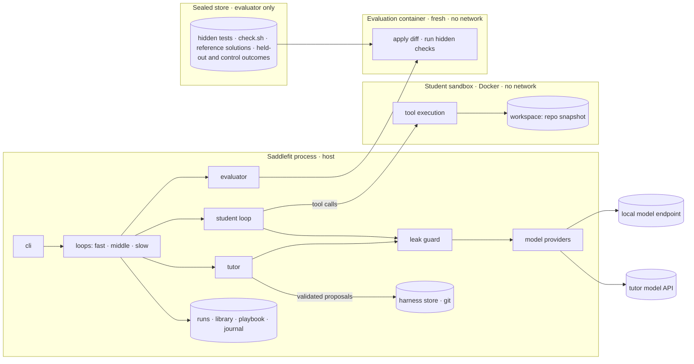

# Architecture

This page summarises Part B of the [specification](SPEC.md); the spec wins on any conflict.

## Invariants

- The student loop runs on the host; tools run in the sandbox through `docker exec`, so model
  calls never leave from inside the sandbox.
- Every prompt to any model passes through the leak guard, which aborts on any known canary.
- Only `saddlefit.eval` reads the sealed store, and it is never mounted into the student
  sandbox. A test enforces the import boundary.
- Budgets and evaluation settings live in `.saddlefit/saddlefit.yaml`, which no model can
  edit; values in the harness's `loop.yaml` are clamped to them.
- Control tasks are evaluated only by `saddlefit report --final`.
- Generated and mutated tasks get a training or held-out split, never control, and are kept
  only after the fail-without, pass-with check and calibration on the current student.
- Fast-loop variants exist only as loop settings for one attempt; nothing the fast loop finds
  reaches the harness store's `main`. It is journaled on probation instead.
- No code the tutor or the generator wrote runs on the host: harness tool scripts are mounted
  read-only into the sandbox, and hooks run there like any tool call.

## Packages

| Package (`src/saddlefit/`) | Responsibility |
| --- | --- |
| `providers` | `ModelClient` protocol; OpenAI-compatible, Anthropic, fake and looped providers |
| `student` | agent loop, tool-calling modes, finish gate, loop detection, compaction |
| `context` | context assembly and budgets |
| `tools` | read, list, search, edit, write, bash, finish |
| `sandbox` | container lifecycle, limits, mounts |
| `harness` | harness store (git), proposal validation and application, allowlist, `loop.yaml` schema |
| `tasks` | suite, splits, canaries, mining, mutation, generation |
| `eval` | evaluator, tamper detection, failure taxonomy, statistics, leak guard |
| `loops` | fast, middle and slow loops |
| `tutor` | diagnosis and proposals; prompts as Markdown files |
| `reports` | reports, delegation map, failure profile |
| `export` | SKILL.md, AGENTS.md, hooks |
| `playbook` | the starter playbook: mechanics as `loop.yaml` values, turned into proposals |
| `storage` | JSONL runs, library, journal, progress; schema migrations |
| `config`, `cli` | configuration and commands |

The spec's table puts the playbook under `storage`. In the code, the starter playbook is
read-only package data (`playbook`); `storage` will hold the playbook statistics that the
slow loop records.
